# Verified community (demo)

A faith-based community where every member is approved by a person, by video, before anyone can see them.
This Phase 1 demo covers joining and video verification, the moderator dashboard, discover, profiles, message requests,
block and report, privacy settings, account status screens and a membership concept.

**Live demo:** https://verified-community-demo.vercel.app

**Access rules test report:** [docs/access-rules-report.pdf](docs/access-rules-report.pdf) (122 checks, all passing)

## Demo logins

| Role | Email | Password |
| --- | --- | --- |
| Moderator and admin | `anna@example.com` | `Anna-moderator-2026` (sign in at [/mod/login](https://verified-community-demo.vercel.app/mod/login)) |
| Approved member | `ruth@example.com` | `Ruth-demo-2026` |
| Member under review | `daniel@example.com` | `Daniel-demo-2026` |

The sign-in screens have buttons that fill these in. The demo is seeded with approved members in five countries, members
waiting for review, a rejected, a suspended and a banned member, open message requests and an audit history.
The moderator's **Members → Reset demo** button restores this starting state.

## Screenshots

<table>
<tr>
<td align="center">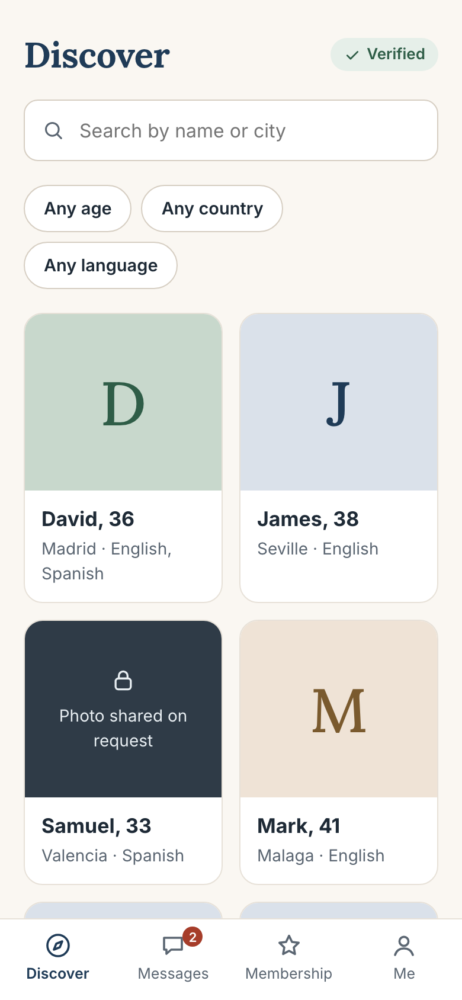<br>Discover</td>
<td align="center">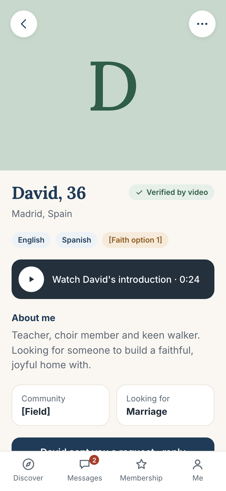<br>Member profile</td>
<td align="center">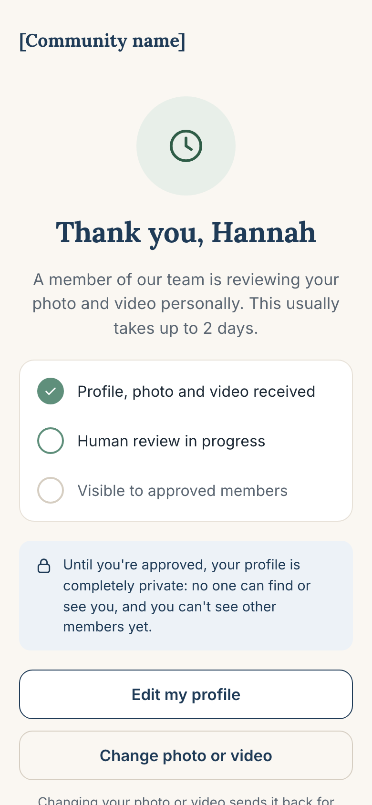<br>Under review</td>
<td align="center">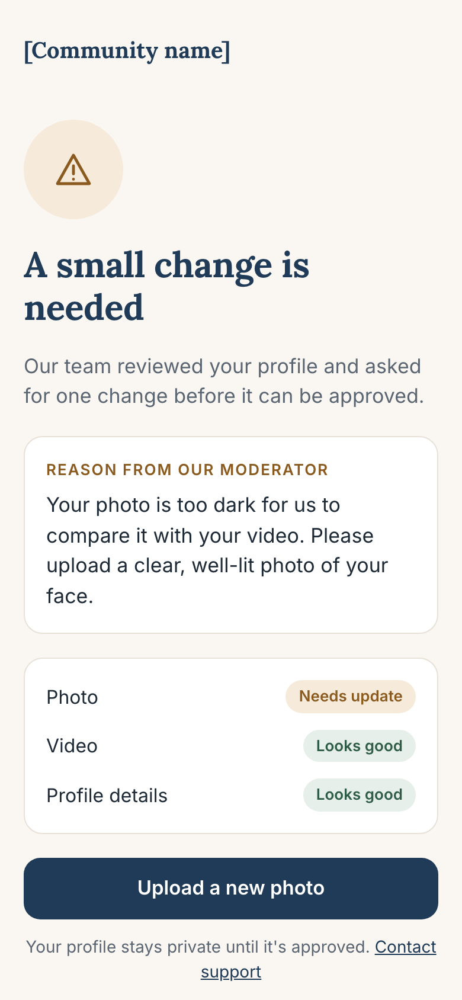<br>Changes requested</td>
</tr>
</table>

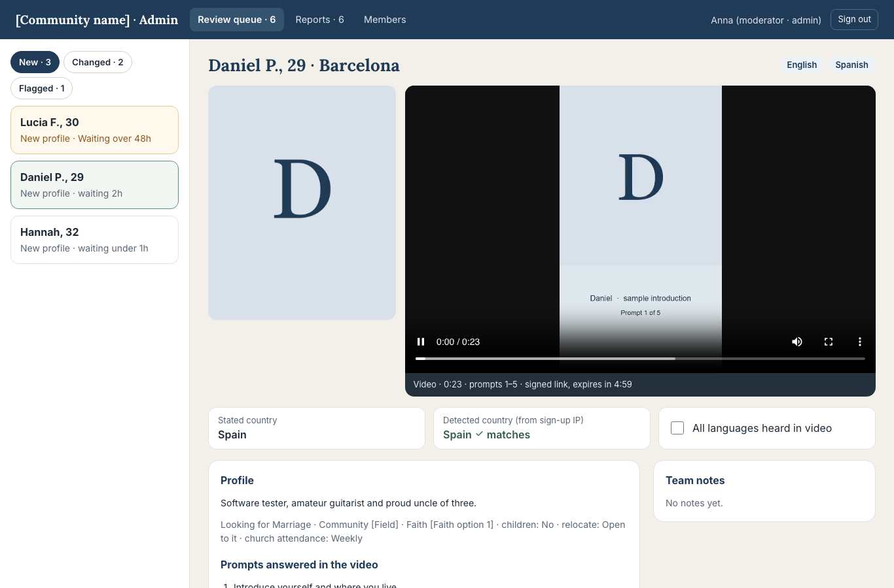

## Designs

The app follows this 16-screen app flow: 13 member screens and 3 moderator and admin screens.

<table>
<tr>
<td align="center">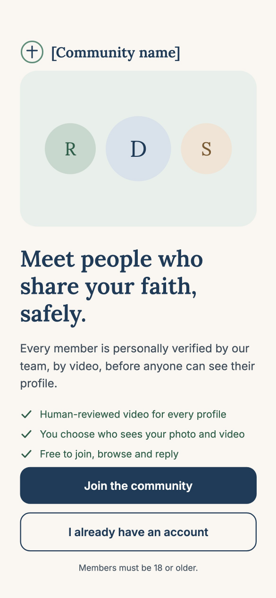<br>01 Welcome</td>
<td align="center">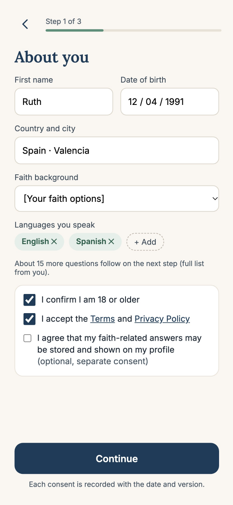<br>02 Create account and consents</td>
<td align="center">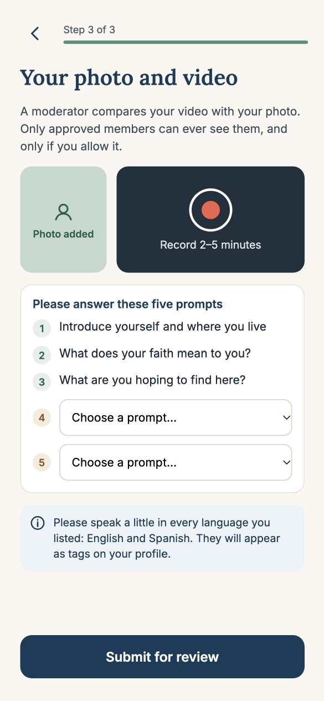<br>03 Photo and video verification</td>
<td align="center">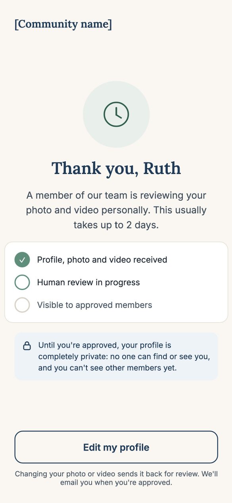<br>04 Under review (invisible)</td>
</tr>
<tr>
<td align="center">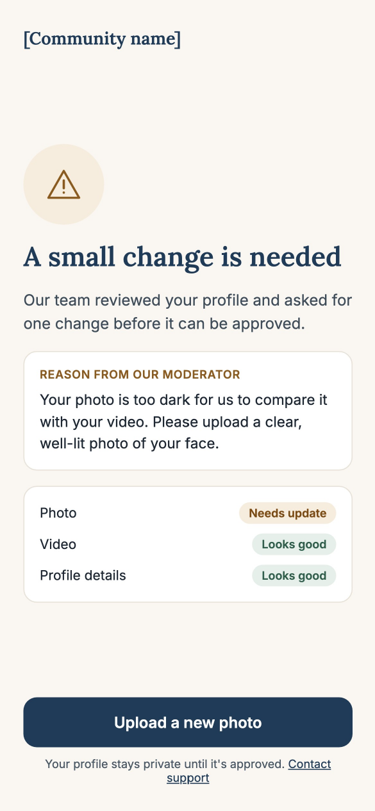<br>05 Changes requested</td>
<td align="center">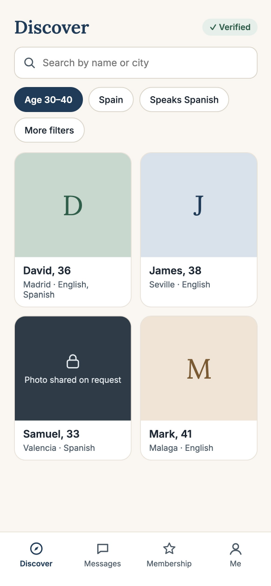<br>06 Discover and filters</td>
<td align="center">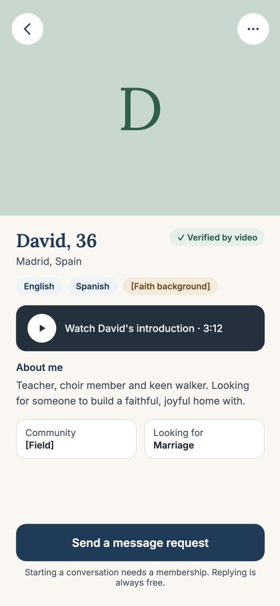<br>07 Member profile</td>
<td align="center">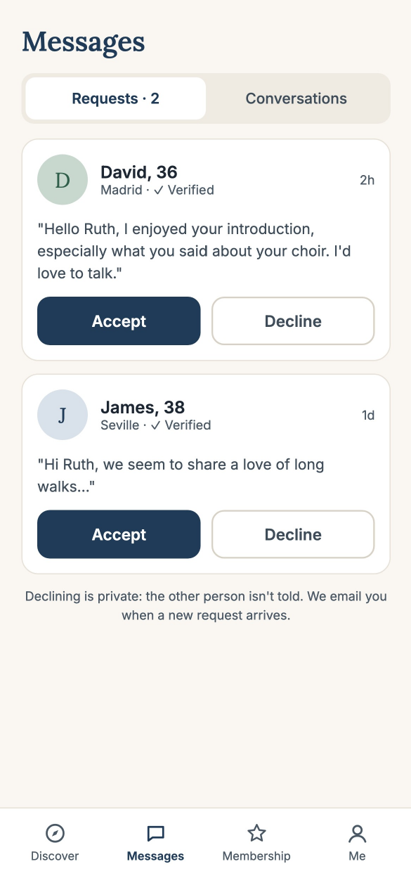<br>08 Message requests</td>
</tr>
<tr>
<td align="center">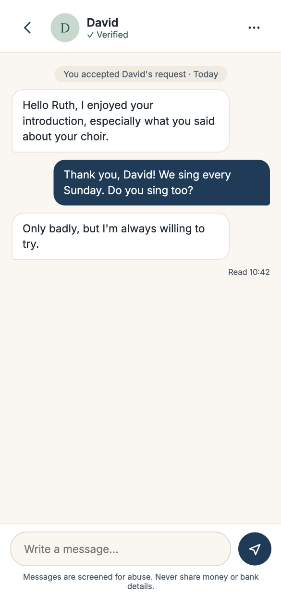<br>09 Conversation</td>
<td align="center">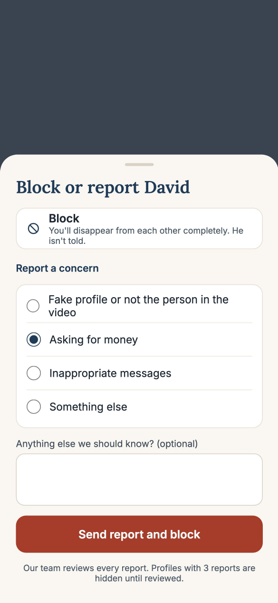<br>10 Block and report</td>
<td align="center">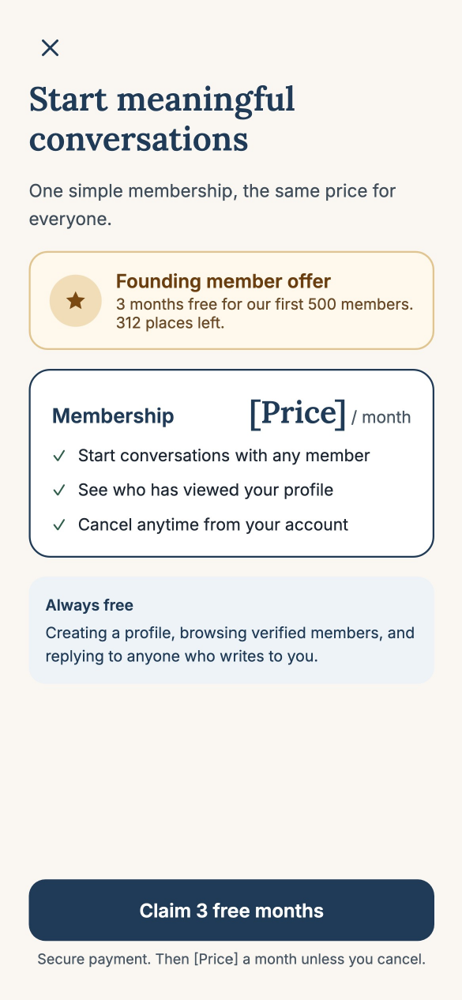<br>11 Membership</td>
<td align="center">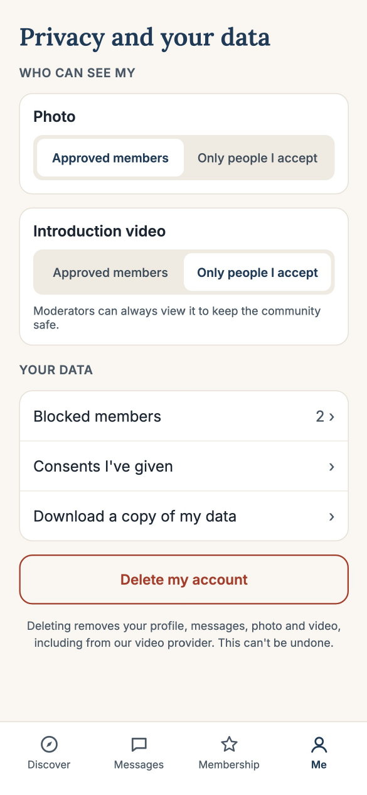<br>12 Privacy and your data</td>
</tr>
<tr>
<td align="center">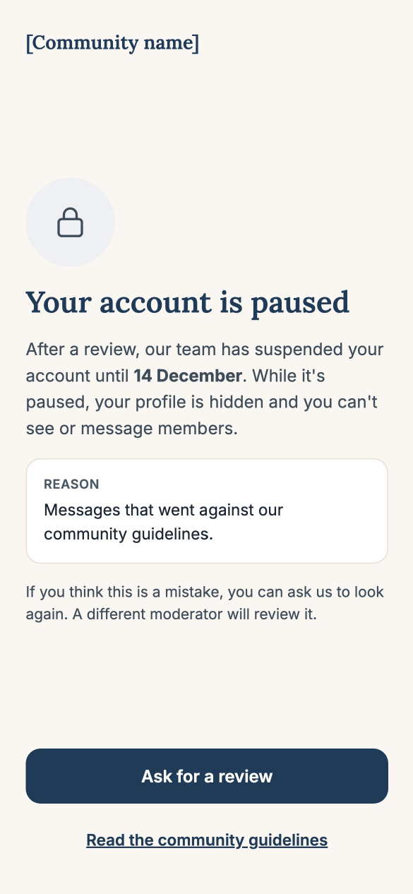<br>13 Account suspended</td>
<td></td><td></td><td></td>
</tr>
</table>

**14 Moderator review queue**

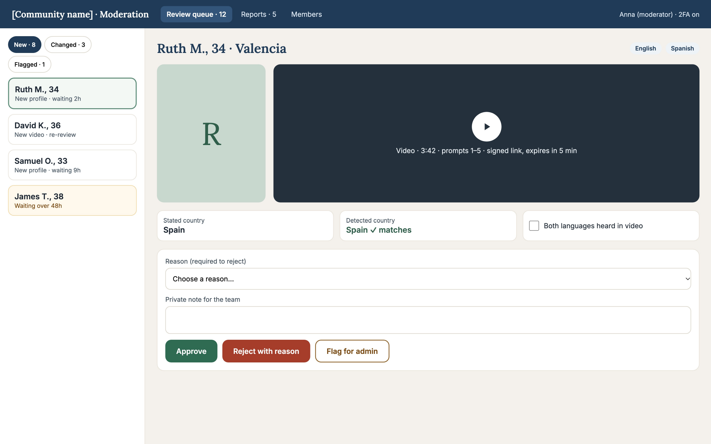

**15 Reports and safety**

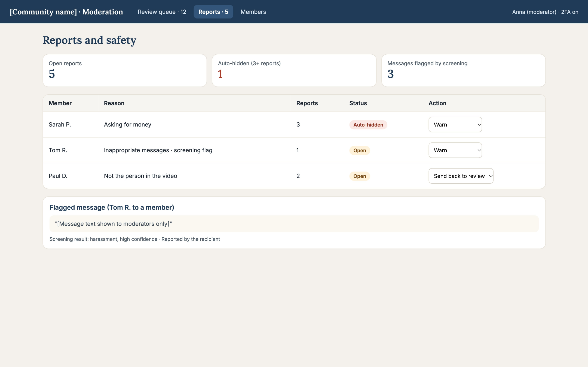

**16 Admin: members and audit log**

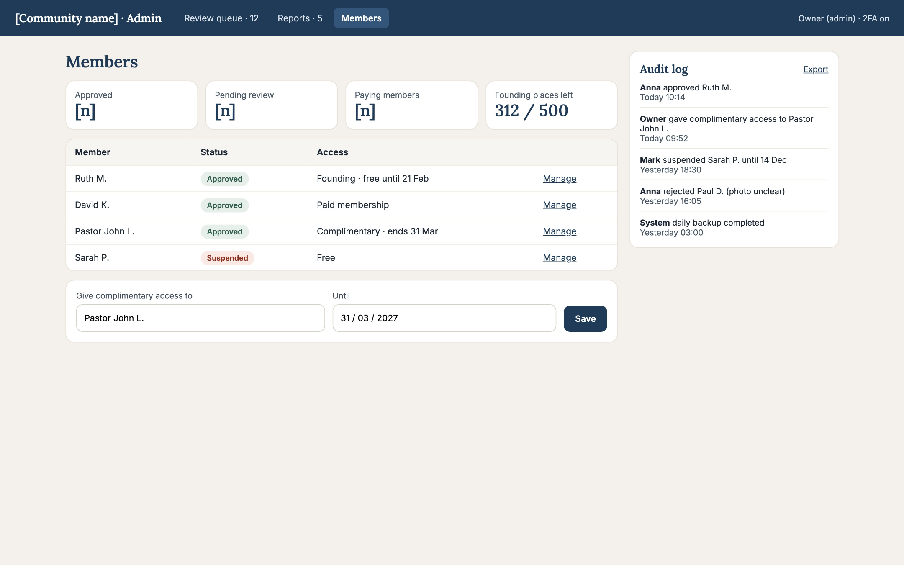

## Security model

Visibility is enforced in the database, not in the screens. Calling the API directly gives the same answer as the app.

- **Row-level security.** Members can read only their own rows. No table accepts direct inserts, updates or deletes from
  the API. Every change goes through a database function that checks who is calling first.
- **One visibility rule.** Other members are reached only through functions (`discover`, `get_member`, conversations)
  that apply one rule: both people approved and not hidden, and neither has blocked the other. A pending, rejected,
  suspended, banned, hidden or blocked profile returns nothing, so its URL is a 404.
- **Re-review on change.** Replacing a photo or video puts an approved member back into the review queue and hides them
  straight away.
- **Signed media links.** Photos and videos sit in a private storage bucket and are served only through signed links
  that expire after 5 minutes. A storage policy decides who may create a link: only for the exact files on a profile the
  viewer is allowed to see, and only if the owner's photo and video setting allows it.
- **Staff roles.** Moderators and admins are rows in a `staff` table that nobody can write to through the API, staff
  included. Moderator functions check that table, and admin-only actions check the admin role. Moderators see flagged
  messages only, never ordinary conversations.
- **Audit log.** Every moderation decision and account action is written to an audit log that nobody can edit.
- **Server-only service key.** The Supabase service key is used only in server routes (account creation, demo reset,
  health check) and never reaches the browser.
- **Age and consent.** 18+ is checked at sign-up and again in the database. Each consent is stored with its date and
  version.

## Access tests

`tests/access-rules.mjs` signs in through the public API as each kind of member and tries to reach data it shouldn't:

- signed out, pending, rejected, suspended, banned and hidden members
- an approved member, and a member blocked by another
- a moderator

For each one it checks tables, functions and storage links directly. It also runs the key workflows: under-18 sign-up,
consents, approve and reject with reason, replaced media going back to review, three reports hiding a profile, the audit
log and suspension expiry. Every check is recorded as PASS or FAIL in an HTML and PDF report.

`tests/walkthrough.mjs` clicks through every flow in a real browser at phone and desktop sizes and saves screenshots.

```bash
node tests/access-rules.mjs https://verified-community-demo.vercel.app   # writes the access rules report
node tests/walkthrough.mjs  https://verified-community-demo.vercel.app   # ENGINE=webkit for Safari
```

Both need `.env.local` (see below) and reset the demo data before and after running.

## Tech stack

- Next.js 15 (App Router, TypeScript), hosted on Vercel
- Supabase: Postgres with row-level security, Auth, private Storage
- Playwright for the browser and report tests

## Run locally

```bash
cp .env.example .env.local        # Supabase URL, anon key, service key, seed password, cron secret
npm install
supabase link --project-ref <ref> && supabase db push
./scripts/make-media.sh           # abstract sample photos and videos (needs ffmpeg)
node scripts/seed.mjs             # demo accounts, media and seed data
npm run dev
```

## Production notes

- Video: move to a video service with signed playback tokens (same 5-minute pattern) and resumable uploads for
  2–5 minute recordings. The demo caps uploads at 50 MB.
- Payments: the membership screen is a concept in demo mode, so no payment is taken.
- Email notifications and two-factor sign-in for staff come in the full build.
